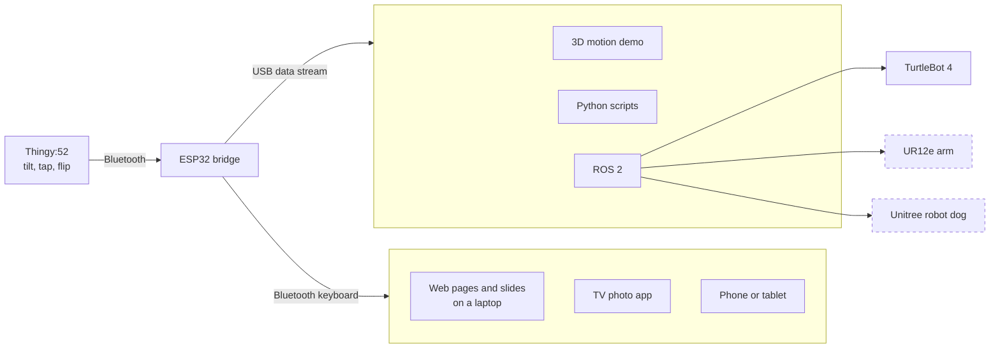

# Thingy Bridge

Tilt, tap, and flip a Nordic Thingy:52 to control TVs, web pages, and robots.

An ESP32 reads the Thingy's motion sensor over Bluetooth and does two things with it at once: it acts as a **Bluetooth keyboard**, so anything that accepts a keyboard can be controlled with no extra software, and it **streams the motion over USB**, so programs can use the full orientation. No wiring and no changes to the Thingy's firmware.

## Demo

https://github.com/user-attachments/assets/b8918524-0886-4315-85d4-fd0ae7ef2773

Tilting the Thingy moves the 3D view in the motion demo and steps through a web page in real time.

## One controller, many machines



Dashed boxes are planned.

| Application | Output | Status |
|---|---|---|
| Web pages, slides, and keyboard-driven apps on a laptop | Keyboard | Tested on macOS |
| [3D motion demo](web/motion-demo.html) | USB stream | Tested |
| [Example web page](examples/keyboard-webpage/index.html) | Keyboard | Tested |
| TV photo app (LG webOS) | Keyboard | Ready to try |
| [Python scripts](python/thingy_bridge.py) | USB stream | Included |
| [TurtleBot 4 driving with ROS 2](examples/ros2/tilt_teleop.py) | USB stream | Example, not yet run on a robot |
| UR12e arm | USB stream | Planned |
| Unitree robot dog | USB stream | Planned |

## Gestures

Hold the Thingy flat, logo up.

| Gesture | Key | In the stream |
|---|---|---|
| Tilt left / right | Left / Right | `lr` angle and a `key` event |
| Tilt forward / back | Up / Down | `ud` angle and a `key` event |
| Single tap | Enter | `key` event |
| Double tap | Play/Pause | `key` event |
| Flip face down for about 1 second | Escape | `key` event |
| Triple tap | Learn "flat" again | |

Holding a tilt repeats the key, faster the further you tilt, so a small tilt steps slowly and a big tilt scrolls quickly. The stream also carries the full orientation (a quaternion) and the gravity vector. See [docs/PROTOCOL.md](docs/PROTOCOL.md).

## Quick start

### You need

| Item | Explain |
|---|---|
| Nordic Thingy:52 | Charged, with its stock firmware |
| ESP32 board | Tested with ESP32-WROOM-32E. Other ESP32 boards with Bluetooth Low Energy should work. |
| USB data cable | Some cables only charge. Use one that transfers data. |
| Arduino IDE 2 | Free, from arduino.cc |

### Set up the firmware

1. In **Arduino IDE > Settings**, add this to "Additional boards manager URLs":
   `https://espressif.github.io/arduino-esp32/package_esp32_index.json`
2. In the **Boards Manager**, install **esp32 by Espressif Systems**.
3. In the **Library Manager**, install **NimBLE-Arduino by h2zero** (version 2.x).
4. Open `firmware/ThingyBridge/ThingyBridge.ino`, choose **Tools > Board > esp32 > ESP32 Dev Module** and the board's port, then **Upload**.

### Try it

1. Pair **Thingy Bridge** in your computer's Bluetooth settings.
2. Close the Arduino Serial Monitor, then open `web/motion-demo.html` in Chrome or Edge and choose **Connect bridge**.
3. Press the Thingy's button to wake it, and hold it still for a second.
4. Tilt it. The 3D view follows, and each gesture shows up as a key marked **Received** once your computer gets it as a keyboard key.

To see the demo page without hardware, open it with `?demo=1` at the end of the address. If something doesn't work, see [docs/TUNING.md](docs/TUNING.md).

### Read the stream in Python

```bash
pip install pyserial
python3 python/thingy_bridge.py
```

```python
from thingy_bridge import Bridge

with Bridge() as bridge:            # finds the port by itself
    for msg in bridge.messages():
        if msg["t"] == "key":
            print("gesture:", msg["k"])
```

### Drive a TurtleBot 4 (ROS 2)

On the computer the bridge is plugged into, with ROS 2 sourced:

```bash
python3 examples/ros2/tilt_teleop.py
```

Double tap to arm, tilt forward and sideways to drive, flip face down to stop. Speeds are capped at 0.15 m/s and 0.8 rad/s by default. Use `--ros-args -p stamped:=true` if your robot expects `TwistStamped`.

## Repository layout

```
firmware/ThingyBridge/     ESP32 firmware (Arduino)
web/motion-demo.html       live 3D view and key check, over USB (Web Serial)
python/thingy_bridge.py    Python reader for the USB stream
examples/keyboard-webpage/ a web page controlled only by keys
examples/ros2/             tilt to drive a mobile robot
docs/PROTOCOL.md           keys, stream format, and commands
docs/TUNING.md             settings and troubleshooting
```

## Safety with robots

The stream gives a program everything it needs to move a machine, so treat the bridge like any teleoperation device:

- Start disarmed, and require a deliberate gesture to arm.
- Cap speeds, and stop whenever data is late or the Thingy disconnects.
- Test in simulation first, keep the robot's emergency stop within reach, and keep people clear of arms.

`examples/ros2/tilt_teleop.py` follows these rules and is a starting point for other robots.

## Roadmap

- UR12e arm: Cartesian jogging through MoveIt Servo, with a hold-to-move gesture
- Unitree robot dog: walking and turning through its SDK
- Wireless link to robots (ESP-NOW or Wi-Fi), so the bridge doesn't need a USB cable to a computer
- Learned gestures such as circles and shakes, trained on the quaternion stream
- Key maps that can be changed without reflashing

## Built with

- [Nordic Thingy:52](https://www.nordicsemi.com/Products/Development-hardware/Nordic-Thingy-52) and its stock firmware
- [NimBLE-Arduino](https://github.com/h2zero/NimBLE-Arduino) by h2zero
- [Arduino core for the ESP32](https://github.com/espressif/arduino-esp32) by Espressif

## License

MIT. See [LICENSE](LICENSE).
