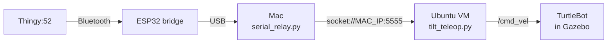

# Drive a simulated robot with the Thingy (Mac + UTM)

Tilt the Thingy to drive a simulated TurtleBot in Gazebo, running in an Ubuntu virtual machine on an Apple Silicon Mac. The bridge stays plugged into the Mac, and a small relay passes its stream to the virtual machine over the network, so no USB passthrough is needed.

https://github.com/user-attachments/assets/0d968c52-f987-4dff-b26a-3f040a129814



Tested on a MacBook Pro (M4 Pro) with UTM, Ubuntu 24.04 ARM64, ROS 2 Jazzy, and Gazebo Harmonic. The TurtleBot3 World runs smoothly. The TurtleBot 4 simulator also works, but its 3D camera makes it slow in a virtual machine.

## 1. Create the virtual machine (once)

1. Install **UTM** from mac.getutm.app (free; the App Store version is the same app, paid).
2. Download **Ubuntu 24.04 for ARM64**. If ubuntu.com offers a Desktop image for ARM, use it. Otherwise use the Server image and add the desktop in step 5.
3. In UTM, choose **Create a New Virtual Machine > Virtualize > Linux**. Leave **Use Apple Virtualization** off: the default (QEMU) offers 3D graphics. Give it 8 to 16 GB of memory, 8 or more CPU cores, and at least 64 GB of storage.
4. Before starting it, open the VM's settings, go to **Display**, and choose **virtio-gpu-gl-pci (GPU Supported)**.
5. Install Ubuntu. If you used the Server image, add a desktop and restart:
   ```bash
   sudo apt update && sudo apt install -y ubuntu-desktop-minimal spice-vdagent
   sudo reboot
   ```

## 2. Install ROS 2 Jazzy and the simulators (once)

In the virtual machine, follow the official ROS 2 Jazzy install steps for Ubuntu at docs.ros.org. Then:

```bash
sudo apt update
sudo apt install -y ros-jazzy-desktop ros-jazzy-turtlebot3-gazebo python3-serial git
echo "source /opt/ros/jazzy/setup.bash" >> ~/.bashrc
echo "export TURTLEBOT3_MODEL=burger" >> ~/.bashrc
source ~/.bashrc
git clone https://github.com/ShawnLiNU/thingy-bridge.git
```

Pyserial comes from apt (`python3-serial`), because Ubuntu 24.04 blocks `pip install` outside a virtual environment. For the TurtleBot 4 simulator as well, add `ros-jazzy-turtlebot4-simulator ros-jazzy-irobot-create-nodes`.

## 3. Start the simulator

```bash
ros2 launch turtlebot3_gazebo turtlebot3_world.launch.py
```

Gazebo opens with the small TurtleBot3 "burger" among round pillars inside a hexagon. If Gazebo crashes, or its window stays black, run `export LIBGL_ALWAYS_SOFTWARE=1` first. Software rendering is slower but always works.

**Show the lidar beams:**

1. Click the **⋮** menu at the top right of Gazebo, search for **Visualize Lidar**, and add it.
2. In its panel, click the refresh button and choose the lidar topic (usually `/scan`; `gz topic -l | grep -i scan` lists it).
3. Set **Visual type** to **Rays**. Turn off **Display non-hitting rays** for a cleaner look.

**Look straight down:** add **View Angle** from the same menu and click its top view. To keep both panels for next time, choose **Save client configuration** from the ☰ menu.

**Check the message type the robot expects:**

```bash
ros2 topic info -v /cmd_vel
```

Look at the Subscription's **Topic type**: `geometry_msgs/msg/Twist` means `stamped:=false` in step 5, and `TwistStamped` means `stamped:=true`.

## 4. Share the bridge with the virtual machine (on the Mac)

1. Plug the bridge into the Mac. Close the Arduino Serial Monitor and the motion demo page, since only one program can use the port.
2. **Turn off the bridge's keyboard on the Mac:** in **System Settings > Bluetooth**, disconnect or forget **Thingy Bridge**. Otherwise every tilt also types arrow keys into the window that has focus, and Gazebo uses them to move its camera. The bridge's link to the Thingy keeps working.
3. In the VM, find the Mac's address:
   ```bash
   ip route | grep default
   ```

| The address after `via` is | Network mode | On the Mac, run | `MAC_IP` in step 5 |
|---|---|---|---|
| `192.168.64.1` | Shared Network | `python3 python/serial_relay.py` | `192.168.64.1` |
| Your router, like `192.168.1.1` | Bridged | `python3 python/serial_relay.py --host $(ipconfig getifaddr en0)` | The Mac's address that command uses (`ipconfig getifaddr en0`) |

If macOS asks whether Python may accept incoming connections, choose **Allow**. The relay prints "Program connected" when the VM connects. The bridge restarts once when the relay opens its port, which is normal.

Shared Network keeps the relay private between the Mac and the VM. Bridged mode is what you'll want later for a real robot, since ROS 2 needs the VM and the robot on the same network.

## 5. Drive

Check the link first (use your `MAC_IP`):

```bash
python3 ~/thingy-bridge/python/thingy_bridge.py --port socket://MAC_IP:5555
```

Tilt the Thingy and the numbers should change. Press Ctrl+C, then start driving the TurtleBot3:

```bash
python3 ~/thingy-bridge/examples/ros2/tilt_teleop.py --ros-args \
  -p port:=socket://MAC_IP:5555 -p stamped:=false -p max_linear:=0.2 -p max_angular:=1.5
```

1. Press the Thingy's button to wake it.
2. **Double tap** to arm, then hold the Thingy the way you like to hold it for a moment. That position becomes "flat", so no tilt means no motion. The terminal says "Ready: tilt to drive."
3. **Tilt forward** to drive, and **left or right** to turn. Tilt further to go faster.
4. **Put it down** on the table, and the robot stops while it lies still. Pick it up to drive again.
5. **Flip it face down** to stop and disarm.

The teleop switches to simulation time by itself when it finds a simulator, so the robot's own safety timeout works, and it sends a final stop on Ctrl+C or when the bridge disconnects.

| Parameter | Explain |
|---|---|
| `max_linear`, `max_angular` | Top speeds. The burger's limits are about 0.22 m/s and 2.8 rad/s. |
| `deadzone_deg` | Tilts smaller than this do nothing (default 8) |
| `stop_when_still` | Stop while the Thingy lies still (default `true`) |
| `still_deg`, `still_s` | How still, and for how long, counts as lying down (0.6 degrees for 1.5 s). Raise `still_deg` if it doesn't stop on the table; lower it if it stops while you hold it very steadily. |
| `flat_on_arm` | Learn "flat" each time you arm (default `true`) |
| `start_armed` | Skip the double tap (simulators only) |

## 6. Record a demo video

**OBS Studio** (free, obsproject.com) can put the camera view of your hand in a corner of the screen recording:

1. Add a **macOS Screen Capture** source and pick the UTM window.
2. Add a **Video Capture Device** source: the Mac's camera, or your iPhone through Continuity Camera. Shrink it into a corner.
3. Use the top view with the lidar beams, then click **Start Recording**.

To make a GIF for the README:

```bash
mkdir -p docs/media
ffmpeg -i demo.mp4 -vf "fps=12,scale=960:-1:flags=lanczos,split[a][b];[a]palettegen[p];[b][p]paletteuse" -loop 0 docs/media/sim-demo.gif
```

Keep the GIF under about 10 MB: a clip of 10 to 15 seconds works well. For a longer video, upload the MP4 through GitHub's editor instead.

## The TurtleBot 4 simulator

It works the same way, with two differences: its `/cmd_vel` is TwistStamped, and it starts on its dock.

```bash
ros2 launch turtlebot4_gz_bringup turtlebot4_gz.launch.py world:=maze
ros2 action send_goal /undock irobot_create_msgs/action/Undock "{}"
python3 ~/thingy-bridge/examples/ros2/tilt_teleop.py --ros-args \
  -p port:=socket://MAC_IP:5555 -p stamped:=true -p max_linear:=0.3 -p max_angular:=1.2
```

The maze is lighter than the default warehouse. If backing up stops after a short distance, that's the Create 3 base's own safety rule: it has no cliff sensors at the back.

## If the simulation is slow

The **Real Time Factor** at the bottom right of Gazebo shows how fast the simulation runs compared with real time. At 15%, one simulated second takes about 7 real seconds.

1. **Use the TurtleBot3 World.** The TurtleBot 4's 3D camera is the biggest cost in a virtual machine.
2. **Check whether the GPU is used:** `sudo apt install -y mesa-utils && glxinfo -B | grep -i renderer`. "llvmpipe" means software rendering, so keep `LIBGL_ALWAYS_SOFTWARE=1` only if Gazebo crashes without it.
3. **Give the VM more CPU cores**, and close other apps.

## If the VM can't reach the relay

"Connection refused" means the relay isn't running. "Timed out" means the connection never got an answer. Check, in the VM:

```bash
ip route | grep default        # the address after "via" is the Mac (Shared Network)
nc -vz MAC_IP 5555             # "succeeded" means the relay is reachable
```

| Item | Explain |
|---|---|
| You used 192.168.64.1, but the VM is in Bridged mode | Use the Mac's address on your router's network, as in the table in step 4 |
| `nc` times out | The Mac's firewall is dropping it. In **System Settings > Network > Firewall**, allow incoming connections for Python, or turn off **Block all incoming connections** and **stealth mode**. |
| The Mac blocks all incoming connections (common on managed work laptops) | Reverse the direction, as below |
| 10.0.2.2 appears instead (Emulated VLAN) | Run the relay with `--host 127.0.0.1` and use `socket://10.0.2.2:5555` |

**Reversed direction (the VM listens, the Mac connects out):**

```bash
# In the VM: note its address, then listen
hostname -I
sudo apt install -y socat
socat TCP-LISTEN:5555,reuseaddr PTY,link=/tmp/thingy,raw,echo=0

# On the Mac (use the VM's address)
python3 python/serial_relay.py --connect VM_IP:5555

# In a second VM terminal
python3 ~/thingy-bridge/examples/ros2/tilt_teleop.py --ros-args \
  -p port:=/tmp/thingy -p stamped:=false -p max_linear:=0.2 -p max_angular:=1.5
```

If the relay stops, socat exits too. Start socat again first, then the relay.

## If something else goes wrong

| Item | Explain |
|---|---|
| The numbers in step 5 don't change | Wake the Thingy, and check that the relay says "Bridge connected" |
| The robot doesn't move | Double tap to arm, check `stamped` matches the type from step 3, and for the TurtleBot 4, undock it |
| Gazebo's camera moves when you tilt | The bridge is still connected as a keyboard on the Mac. Disconnect it in Bluetooth settings. |
| The robot creeps while the Thingy lies flat | Double tap to arm again while holding it the way you like, or raise `deadzone_deg` |

To stop the robot right away from any terminal:

```bash
ros2 topic pub --once /cmd_vel geometry_msgs/msg/Twist "{}"           # TurtleBot3
ros2 topic pub --once /cmd_vel geometry_msgs/msg/TwistStamped "{}"    # TurtleBot 4
```
