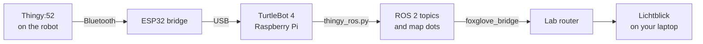

# Thingy Bridge on a TurtleBot 4

The Thingy rides on the robot and the bridge plugs into the robot's Raspberry Pi. `examples/ros2/thingy_ros.py` publishes every reading as a ROS 2 topic and draws a colored dot on the robot's map for each reading. Lichtblick, an open-source robotics viewer, shows it all live from your laptop.



## 1. Mount the Thingy

Put it on the robot's top plate, as far as you can from the Raspberry Pi and the motors, so their heat doesn't raise the temperature readings. A small stand of a few centimeters helps air reach it. Set its height with `mount_xyz` (step 4) if you want it drawn in the right place.

Charge it first, and let the gas sensor warm up for about 20 minutes before mapping air quality.

## 2. Plug in the bridge and give it a fixed name

The TurtleBot 4's lidar is also a USB serial device, so the bridge needs a name of its own. Plug the bridge into a free USB port on the robot, then over SSH:

```bash
ls /dev/ttyUSB* /dev/ttyACM*            # note the ports, unplug the bridge, run again
udevadm info -q property -n /dev/ttyUSB1 | grep -E "ID_VENDOR_ID|ID_MODEL_ID|ID_PATH="
```

Use the port that disappeared when you unplugged the bridge in place of `/dev/ttyUSB1`.

**If the vendor and model IDs differ from the lidar's** (the lidar is usually `10c4` and `ea60`), match on them:

```bash
echo 'SUBSYSTEM=="tty", ATTRS{idVendor}=="1a86", ATTRS{idProduct}=="7523", SYMLINK+="thingy_bridge", MODE="0666"' \
  | sudo tee /etc/udev/rules.d/99-thingy-bridge.rules
```

**If they're the same as the lidar's,** match on the physical USB port instead, using the `ID_PATH` value you saw. Then always plug the bridge into that same port:

```bash
echo 'SUBSYSTEM=="tty", ENV{ID_PATH}=="PASTE_ID_PATH_HERE", SYMLINK+="thingy_bridge", MODE="0666"' \
  | sudo tee /etc/udev/rules.d/99-thingy-bridge.rules
```

Then reload, and check:

```bash
sudo udevadm control --reload-rules && sudo udevadm trigger
ls -l /dev/thingy_bridge
```

All the scripts in this repo use `/dev/thingy_bridge` automatically when it exists. Without it, they skip the lidar's port and stop with a message if more than one port is still possible.

## 3. Install the pieces on the robot

```bash
pip install pyserial
sudo apt install ros-$ROS_DISTRO-foxglove-bridge
```

Copy `examples/ros2/thingy_ros.py` to the robot, or clone the repo there.

## 4. Run

Start mapping, or localization with a saved map, so the robot knows where it is:

```bash
ros2 launch turtlebot4_navigation slam.launch.py
```

In a second terminal, start the Thingy node:

```bash
python3 thingy_ros.py --ros-args -p map_value:=tvoc -p csv:=~/thingy_log.csv
```

In a third, start the bridge to Lichtblick:

```bash
ros2 launch foxglove_bridge foxglove_bridge_launch.xml
```

Drive the robot around with its usual teleop, or send it navigation goals. Stopping for a few seconds at each spot gives better temperature and humidity readings.

| Parameter | Explain |
|---|---|
| `map_value` | What the dots show: `temperature`, `humidity`, `pressure`, `eco2`, `tvoc`, or `light` |
| `map_min`, `map_max` | Fixed color range. Without them, the colors stretch to fit the readings so far. |
| `marker_spacing` | Meters between dots (default 0.25) |
| `csv` | A file that logs every reading with the robot's position, for analysis later |
| `mount_xyz` | Where the Thingy sits on the robot, in meters from `base_link` |
| `map_frame`, `base_frame` | Change these if your robot uses a namespace or other frame names |
| `port` | Set this only if the bridge isn't found automatically |

## 5. View it in Lichtblick

Use the **Lichtblick desktop app** from the project's GitHub releases page, or run it locally with Docker:

```bash
docker run --rm -p 8080:8080 ghcr.io/lichtblick-suite/lichtblick:latest   # then open http://localhost:8080
```

A local copy matters: a secure (https) web page is usually blocked from connecting to an unsecured address on your lab network.

Open a connection, choose **Foxglove WebSocket**, and enter `ws://ROBOT_IP:8765`. Then add these panels:

| Panel | Show |
|---|---|
| 3D | `/map`, `/scan`, and `/thingy/reading_map`. The dots appear on the map as the robot drives: blue is low, red is high. |
| Plot | `/thingy/temperature.temperature`, `/thingy/humidity.relative_humidity`, `/thingy/tvoc.data`, `/thingy/eco2.data` |
| Gauge | `/thingy/battery.percentage` |
| Raw Messages | `/thingy/gesture`, to see taps and flips |

Save the layout from Lichtblick's layout menu so it opens the same way next time.

## Topics

| Topic | Type | Content |
|---|---|---|
| `/thingy/imu` | `sensor_msgs/Imu` | Orientation and gravity |
| `/thingy/tilt` | `geometry_msgs/Vector3` | x: left/right, y: back/forward, in degrees |
| `/thingy/gesture` | `std_msgs/String` | Left, Right, Up, Down, Enter, Back, Play/Pause |
| `/thingy/temperature` | `sensor_msgs/Temperature` | °C |
| `/thingy/humidity` | `sensor_msgs/RelativeHumidity` | 0 to 1 |
| `/thingy/pressure` | `sensor_msgs/FluidPressure` | Pascals |
| `/thingy/eco2` | `std_msgs/Float32` | Estimated CO2, ppm |
| `/thingy/tvoc` | `std_msgs/Float32` | VOCs, ppb |
| `/thingy/light` | `std_msgs/Float32` | Raw brightness, not lux |
| `/thingy/battery` | `sensor_msgs/BatteryState` | 0 to 1 |
| `/thingy/reading_map` | `visualization_msgs/Marker` | One dot per reading, in the map frame |

## Good to know

| Item | Explain |
|---|---|
| eCO2 | Calculated from VOCs, so it's good for comparing places but isn't a true CO2 measurement. A real CO2 sensor such as the SCD40 can be added to the ESP32 later. |
| No dots appear | The robot needs a position on a map. Check that SLAM or localization is running, and look for the "No robot position yet" message. |
| Readings stop | The Thingy may have gone to sleep or run low. Press its button, and check `/thingy/battery`. |
| Permission denied on the port | Add your user to the serial group with `sudo usermod -aG dialout $USER`, then log out and back in |
